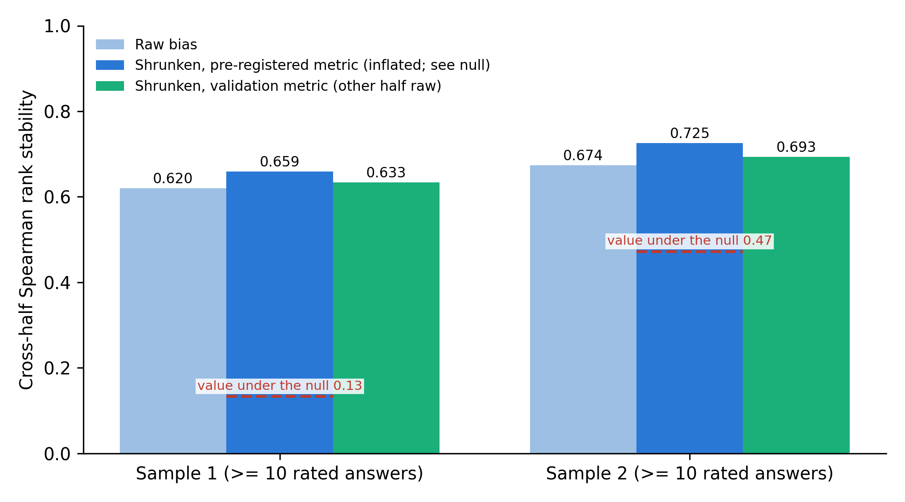

# Supplementary Notes

These notes accompany "How Many Rated Answers Does a Confidence-Calibration Score Need? Conditional Minimum-Response Estimates and a Reusable Protocol from Mathematics Practice Data". S1 = Sample 1; S2 = Sample 2. Design A = students with at least 200 rated answers (S1: 1,389; S2: 554), the same students at every volume N. All analyses in Notes S1 to S3 are exploratory additions to the pre-specified analysis plan, which was frozen before any inferential analysis; they are recorded in its dated, append-only Addendum 3. Note S4 reports the pre-specified H3 analysis and the permutation null added after the plan was frozen (Addendum 1, item 4). The plan with all its addenda is available at https://anonymous.4open.science/r/calibration-minimum-n-protocol-06D2. Bootstrap intervals for a minimum N are percentiles over all 1,000 joint draws, a draw that never reaches the level within 200 answers being ranked above 200.

## Note S1. Estimation Checks for Bias and Brier

For each N, a one-way random-effects model with answers nested in students was fitted to the same Design A subsamples used for the split-half curves. Its reliability of the N-answer mean, ICC(1,N) = (MSB - MSW) / MSB, is the generalizability coefficient of that design; for nested designs the absolute and relative coefficients coincide. Intervals come from a student bootstrap (1,000 draws). A second, split-free estimator uses all rated answers of each pool student (median 268 in S1, 320 in S2) and projects the volume needed for a target reliability t as n = t / (1 - t) x (within-student variance / between-student variance).

Table S1a
Split-Half and Variance-Components Reliability on Identical Subsamples

| Sample, index | N | Split-half | ICC(1,N) [95% CI] |
|---|---|---|---|
| S1, bias | 5 | .420 | .427 [.364, .482] |
| S1, bias | 10 | .611 | .612 [.574, .647] |
| S1, bias | 15 | .705 | .707 [.680, .732] |
| S1, bias | 20 | .754 | .755 [.729, .779] |
| S1, bias | 50 | .889 | .889 [.877, .900] |
| S1, Brier | 5 | .379 | .382 [.314, .443] |
| S1, Brier | 10 | .527 | .529 [.479, .575] |
| S1, Brier | 15 | .644 | .651 [.618, .681] |
| S1, Brier | 20 | .686 | .687 [.655, .716] |
| S1, Brier | 50 | .853 | .853 [.837, .868] |
| S2, bias | 5 | .454 | .459 [.379, .527] |
| S2, bias | 10 | .591 | .585 [.529, .633] |
| S2, bias | 15 | .684 | .684 [.643, .716] |
| S2, bias | 20 | .742 | .741 [.704, .771] |
| S2, bias | 50 | .874 | .873 [.857, .887] |
| S2, Brier | 5 | .330 | .336 [.237, .429] |
| S2, Brier | 10 | .478 | .473 [.386, .544] |
| S2, Brier | 15 | .543 | .544 [.479, .596] |
| S2, Brier | 20 | .568 | .569 [.496, .626] |
| S2, Brier | 50 | .774 | .776 [.741, .802] |

Note. The largest absolute difference over all 11 grid points is .0066 (S1 bias, N = 5); every split-half value lies inside the ICC 95% CI.

Table S1b
Minimum Number of Rated Answers: Split-Half, Variance Components and the Split-Free Estimator

| Sample, index | Split-half .70 [CI] | ICC curve .70 [CI] | Split-free .70 [CI] | Split-half .80 [CI] | ICC curve .80 [CI] | Split-free .80 [CI] |
|---|---|---|---|---|---|---|
| S1, bias | 14.7 [13.1, 16.9] | 14.6 [13.2, 16.5] | 14.7 [13.2, 16.4] | 26.0 [23.4, 28.4] | 26.1 [23.3, 28.4] | 25.2 [22.7, 28.2] |
| S1, Brier | 21.3 [18.2, 23.9] | 21.3 [18.2, 24.0] | 19.8 [17.9, 22.1] | 34.3 [30.3, 38.4] | 34.7 [31.1, 38.7] | 33.9 [30.7, 37.8] |
| S2, bias | 16.2 [14.4, 19.2] | 16.3 [14.4, 19.6] | 16.6 [14.5, 19.1] | 28.7 [24.2, 33.8] | 28.8 [24.4, 33.5] | 28.4 [24.9, 32.8] |
| S2, Brier | 31.1 [24.6, 35.5] | 31.1 [24.9, 35.6] | 29.9 [26.0, 35.6] | 58.8 [46.0, 69.2] | 58.3 [48.1, 69.2] | 51.3 [44.5, 61.0] |

Reliability of a single rated answer from the split-free estimator is .137 (bias) and .105 (Brier) in S1, and .123 and .072 in S2.

Coefficient alpha requires a crossed students-by-items matrix. In S2, 14 quizzes had at least 300 students who gave a rating on every question of the quiz (12 to 18 items; 4,973 quiz-student rows, not distinct students); in S1 no quiz reached 100 such students, so S1 alpha was not computed. The subset is selected and is a different population from Design A.

Table S1c
Crossed S2 Subset: Alpha, Phi and the Split-Half Estimator (Medians Over 14 Quizzes)

| Index | Alpha | Phi | One-way ICC(1,k) | Split-half, per-student halves (as in the main analysis) | Split-half, one common partition | Alpha minus per-student split-half, median (range) | Quizzes with alpha higher |
|---|---|---|---|---|---|---|---|
| Bias | .718 | .699 | .690 | .689 | .718 | +.022 (+.006 to +.064) | 14 of 14 |
| Brier | .572 | .562 | .554 | .551 | .573 | +.039 (+.013 to +.084) | 14 of 14 |

Note. Alpha (Cronbach, 1951) treats item difficulty as common to all students and removes it from error, which suits rank-order use on a fixed form. Phi counts the item effect as error, which suits absolute statements (bias against zero). Per-student halves treat item effects as error, as in the platform data. Item variance was a median 6.5% (bias) and 6.7% (Brier) of error variance. With the 42 quizzes that had at least 100 such students, the median alpha minus split-half difference was +.026 (bias) and +.040 (Brier).

Table S1d
Standard Error of Measurement of Bias, in Points on the 0-100 Confidence Scale (Design A)

| Sample, N | SD of observed bias | SEM | Median half-width of a student's own 95% interval |
|---|---|---|---|
| S1, 15 | 19.9 | 10.8 | 21.3 |
| S1, 20 | 19.0 | 9.4 | 18.8 |
| S1, 30 | 18.4 | 7.6 | 15.3 |
| S1, 50 | 17.7 | 5.9 | 12.0 |
| S2, 15 | 21.5 | 12.1 | 23.4 |
| S2, 20 | 20.3 | 10.3 | 20.6 |
| S2, 30 | 19.2 | 8.4 | 16.9 |
| S2, 50 | 18.5 | 6.6 | 13.2 |

Note. SEM = SD x sqrt(1 - split-half reliability); the variance-components SEM agrees to 0.1 point.

Each reported reliability is the mean of 50 Spearman-Brown values, one per random split of the same subsample. Table S1e gives the Monte Carlo standard error of that mean (the SD of the 50 values divided by the square root of 50). It is not part of the bootstrap intervals, which hold the splits fixed.

Table S1e
Monte Carlo Standard Error of the Mean Over 50 Random Splits (Design A)

| Sample, N | Bias | Brier | Gamma | AUROC | AUROC, tie convention |
|---|---|---|---|---|---|
| S1, 20 | .0016 | .0024 | .0064 | .0062 | .0051 |
| S1, 100 | .0003 | .0005 | .0036 | .0034 | .0030 |
| S1, 200 | .0002 | .0002 | .0041 | .0022 | .0021 |
| S2, 20 | .0021 | .0038 | .0104 | .0092 | .0073 |
| S2, 100 | .0006 | .0010 | .0087 | .0040 | .0038 |
| S2, 200 | .0003 | .0006 | .0077 | .0028 | .0026 |

Two sensitivity analyses use the same subsamples, splits and bootstrap draws as the main curves. The first codes the faces as c' = .25 + .75c, so that the lowest face, documented as a random guess, maps to the 25% guessing rate of a four-option item. The second removes, after subsampling and splitting, the Design A students whose rated answers (all of them) have accuracy of at least .99 or carry one constant rating: 101 of 1,389 in S1 (72 with accuracy of at least .99, 53 of them all correct; 35 with one constant rating) and 15 of 554 in S2 (12, 11 and 4). The 53 and 11 all-correct students were also correct on .993 and .994 of their 3,079 and 2,180 unrated answers; 48 and 8 of them were correct on every unrated answer. Its bootstrap resamples the kept students.

Table S1f
Bias and Brier Under the Guess-Corrected Coding and Without Near-Perfect and Constant Raters (Design A)

| Sample, variant | Bias r(20) [CI] | Bias .70 [CI] | Bias .80 [CI] | Brier r(20) [CI] | Brier .70 [CI] | Brier .80 [CI] |
|---|---|---|---|---|---|---|
| S1, as reported | .754 [.728, .777] | 14.7 [13.1, 16.9] | 26.0 [23.4, 28.4] | .686 [.654, .717] | 21.3 [18.2, 23.9] | 34.3 [30.3, 38.4] |
| S1, c' = .25 + .75c | .724 [.699, .748] | 17.5 [15.1, 20.1] | 29.0 [26.8, 32.6] | .702 [.675, .728] | 19.7 [16.6, 22.0] | 32.2 [29.1, 35.5] |
| S1, without 101 students | .739 [.712, .764] | 16.0 [14.0, 18.3] | 27.5 [24.8, 30.2] | .639 [.601, .675] | 25.6 [22.7, 28.9] | 41.4 [36.6, 47.4] |
| S2, as reported | .742 [.707, .771] | 16.2 [14.4, 19.2] | 28.7 [24.2, 33.8] | .568 [.495, .623] | 31.1 [24.6, 35.5] | 58.8 [46.0, 69.2] |
| S2, c' = .25 + .75c | .693 [.651, .727] | 20.7 [17.8, 24.6] | 36.7 [31.8, 42.4] | .618 [.556, .668] | 26.2 [22.8, 31.6] | 46.4 [37.2, 58.4] |
| S2, without 15 students | .733 [.694, .762] | 17.0 [14.7, 20.5] | 30.5 [25.8, 35.6] | .535 [.453, .598] | 33.9 [29.0, 39.0] | 66.2 [55.6, 77.7] |

Note. Gamma and AUROC depend only on the order of the levels and do not change under the guess-corrected coding.

At N = 20 on two disjoint answer sets per student (the design of Table 7), the +.15 rule flagged 32% of S1 students under the linear coding (retention .663, kappa .506) and 42% under the guess-corrected coding (retention .715, kappa .512); in S2, 42% (.713, .504) and 56% (.766, .469). Without the near-perfect and constant raters it flagged 34% of S1 students (retention .661, kappa .490) and 43% of S2 students (.713, .497).

## Note S2. AUROC Under the Plan Rule and Under the Tie Convention

The frozen plan treats AUROC as undefined whenever gamma is: when all answers are correct, all are incorrect, or all ratings are identical (the plan rule). The analysis code computed AUROC with the Mann-Whitney convention instead: each pair of one correct and one incorrect answer counts 1 if the correct answer has the higher rating, 0.5 if the ratings are tied, and 0 otherwise (the tie convention). AUROC is then undefined only when all answers are correct or all incorrect, and it equals .50 when every answer carries an identical rating. The revised manuscript uses the plan rule for the main results. Both rules were run on identical subsamples, splits and bootstrap draws; every other index is unchanged to the last digit.

Table S2a
Share of Students Without a Usable Resolution Value

| Set | Gamma undefined, and AUROC under the plan rule | AUROC undefined, tie convention | AUROC at the .50 placeholder |
|---|---|---|---|
| S1, Design A, full set, N = 10 | 30.8% | 17.1% | 13.7% |
| S1, Design A, full set, N = 20 | 20.4% | 9.9% | 10.6% |
| S1, Design A, halves, N = 20 | 31.2% | 16.7% | 14.4% |
| S1, all students with >= 10 rated answers (23,825), full set | 17.2% | 10.5% | 6.7% |
| S1, all students with >= 20 rated answers (17,156), full set | 10.3% | 5.6% | 4.7% |
| S2, Design A, full set, N = 20 | 9.7% | 2.9% | 6.9% |
| S2, all students with >= 20 rated answers (2,617), full set | 7.9% | 4.2% | 3.7% |

Note. Shares are rounded separately; unrounded, the gamma share equals the sum of the two tie-convention shares in every row.

The placeholder state persists within students. In S1 at N = 20, a student whose first half had identical ratings had identical ratings in the second half with probability .59, against a base rate of .16 (phi = .51); at N = 100, phi = .66. In S2 at N = 20, phi = .52. Non-placeholder half-set AUROC values in S1 at N = 20 average .644 (SD .199), so the placeholders sit below the typical value and add between-student variance that recurs across halves.

Table S2b
AUROC Reliability and Minimum Number of Rated Answers Under the Two Rules (Design A, Random Halves Unless Stated)

| Quantity | S1 plan rule | S1 tie convention | S1 gamma | S2 plan rule | S2 tie convention | S2 gamma |
|---|---|---|---|---|---|---|
| Reliability at N = 15 (log-linear interpolation between N = 10 and 20) | .145 | .225 | .146 | .079 | .149 | .057 |
| Reliability at N = 20 [95% CI] | .172 [.083, .251] | .257 [.189, .321] | .186 [.089, .272] | .056 [-.077, .170] | .146 [.036, .244] | .047 [-.092, .175] |
| Reliability at N = 100 | .575 | .617 | .440 | .537 | .572 | .414 |
| Reliability at N = 200 | .733 | .756 | .585 | .723 | .742 | .587 |
| Minimum N for .70, Design A [CI] | 172.9 [154.6, 199.0] | 151.1 [133.1, 172.0] | > 200 | 183.8 [159.5, > 200] | 168.7 [144.6, 194.2] | > 200 |
| Share of bootstrap draws reaching .70 within 200 | 97.7% | 100.0% | 0.0% | 89.5% | 99.4% | 1.8% |
| Minimum N for .70, Design B | 170.8 | 151.1 | > 200 | 198.4 | 182.2 | > 200 |
| Spearman-Brown projection for .70 from N = 20 | 225.0 | 135.2 | 204.8 | 782.1 | 272.5 | 945.0 |

Note. No resolution index reached .80 within 200 answers in any design, under either rule. Projections from near-zero anchors (S2) are unstable.

Downstream results under the two rules (S1, N = 20 unless stated): AUROC correlated .019 (plan rule) and -.039 (tie convention) with accuracy; reliability after partialing accuracy was .171 and .257; inverse-probability weighting in Design B moved AUROC reliability from .177 to .177 and from .222 to .223; month-scale test-retest (3,796 students) was .202 (.523 after correction for unreliability) and .247 (.568), against .124 (.397) for gamma. The confirmatory outcomes are identical under both rules: H2's inner Holm p for AUROC is below .001 under both, and the family-level Holm values are 1.0 (H1), .66 (H2) and .003 (H3). The S2 replication criteria are met or failed identically.

## Note S3. Rated Versus Unrated Answers, Weighted Crossings, and the Level of Bias

Table S3a
Rated Minus Unrated Answers Within Students (Mean Over Students [Student-Bootstrap 95% CI])

| Quantity | S1, all unrated answers | S1, same quiz attempts | S2, all unrated answers | S2, same quiz attempts |
|---|---|---|---|---|
| Students | 27,625 | 20,748 | 3,539 | 3,315 |
| Accuracy (percentage points) | +4.0 [3.8, 4.2] | +4.1 [3.8, 4.4] | +7.8 [7.2, 8.3] | +4.8 [4.2, 5.4] |
| Item proportion correct (points; + = rated items easier) | +1.2 [1.1, 1.2] | +2.0 [1.9, 2.1] | +3.6 [3.4, 3.8] | +2.5 [2.3, 2.7] |
| Accuracy beyond item difficulty (points) | +2.8 [2.6, 3.0] | +2.1 [1.8, 2.3] | +4.2 [3.7, 4.7] | +2.3 [1.8, 2.8] |
| Days since the student's first answer | -2.6 [-3.4, -1.7] | -9.3 [-9.8, -8.9] | -38.4 [-39.7, -37.1] | -15.2 [-16.0, -14.3] |
| Relative position in the quiz (0 = first, 1 = last) | not applicable | -.122 [-.124, -.120] | not applicable | -.110 [-.115, -.106] |
| Strand mix: distance observed | .337 | .212 | .343 | .199 |
| Strand mix: distance expected from sampling | .151 | .150 | .110 | .093 |
| Topic mix: distance observed | .659 | .447 | .589 | .382 |
| Topic mix: distance expected from sampling | .391 | .353 | .272 | .223 |

Note. Students with at least 5 rated and 5 unrated answers on the stated basis. Item proportion correct excludes the answer itself. Distance = total variation distance between the strand (topic) distributions of a student's rated and unrated answers (0 = identical, 1 = disjoint); the expected value comes from permuting the rated label within student. In S2, Number questions made up 66.9% of a student's rated answers on average, against 48.0% of the student's unrated answers.

Table S3b
Bias Minimum N Under Reweighting, With Bootstrap Intervals (Design A)

| Variant | S1 .70 [CI] | S1 .80 [CI] | S2 .70 [CI] | S2 .80 [CI] |
|---|---|---|---|---|
| Unweighted (reference) | 14.7 [13.1, 16.9] | 26.0 [23.4, 28.4] | 16.2 [14.4, 19.2] | 28.7 [24.2, 33.8] |
| Weighted to the unrated difficulty mix | 15.9 [13.9, 18.1] | 27.2 [24.6, 30.3] | 17.8 [14.9, 21.2] | 32.4 [27.4, 36.8] |
| Same weights shuffled within student | 15.5 [13.9, 17.9] | 27.5 [25.3, 30.0] | 17.6 [14.8, 21.0] | 31.2 [26.9, 36.6] |
| Weighted to the unrated difficulty-by-strand mix | 24.6 [20.1, 27.1] | 43.8 [37.0, 50.6] | 34.6 [24.8, 39.1] | 65.0 [52.2, 77.4] |
| Same weights shuffled within student | 25.3 [19.7, 27.7] | 42.9 [36.8, 47.1] | 33.8 [24.6, 39.1] | 61.4 [48.5, 73.8] |
| Difficulty-balanced subset, equal weights | 13.9 [12.5, 15.6] | 24.3 [22.0, 27.6] | 15.0 [13.2, 17.9] | 27.6 [23.4, 32.4] |

Note. Students without at least 20 unrated answers (S1: 540 of 1,389; S2: 202 of 554) have no weighting target and keep weight 1. Among students with a target, the weights keep an effective 88.7% (difficulty) and 61.2% (difficulty by strand) of the 20 answers in S1, and 86.8% and 49.9% in S2. Paired change in the .70 crossing against the unweighted curve: S1 +1.3 [0.5, 2.0] for difficulty weights and +0.8 [0.4, 1.5] for their shuffled null; S2 +1.5 [0.5, 3.0] and +1.3 [0.3, 3.0]. Every bootstrap draw reached .70 and .80 within 200 answers for every variant in this table.

Table S3c
Level of Bias on Rated Answers by Item Difficulty, Strand and Term (All Rated Answers)

| Category | S1 share of rated answers | S1 mean bias | S2 share of rated answers | S2 mean bias |
|---|---|---|---|---|
| Hardest fifth of answers by item difficulty | 19.4% | +.212 | 17.3% | +.311 |
| Second fifth | 19.4% | +.116 | 18.2% | +.184 |
| Middle fifth | 20.1% | +.062 | 20.7% | +.113 |
| Fourth fifth | 20.8% | +.019 | 21.4% | +.058 |
| Easiest fifth | 20.3% | -.032 | 22.4% | -.025 |
| Number | 53.8% | +.074 | 60.3% | +.103 |
| Algebra | 19.7% | +.067 | 16.5% | +.122 |
| Geometry and Measure | 18.5% | +.083 | 23.2% | +.151 |
| Data and Statistics | 6.8% | +.061 | no answers | no answers |
| Combined or minor strands | 1.1% | +.084 | no answers | no answers |
| 2018/19 Spring term | 17.4% | +.081 | no answers | no answers |
| 2018/19 Summer term | 13.2% | +.080 | no answers | no answers |
| 2019/20 Autumn term | 37.8% | +.068 | 67.4% | +.109 |
| 2019/20 Spring term | 24.9% | +.077 | 29.0% | +.135 |
| 2019/20 Summer term | 6.7% | +.065 | 3.7% | +.142 |

Note. Answer-level means over all rated answers; bias = mean confidence (0-1) minus accuracy. Difficulty fifths are quintiles of the leave-one-out item proportion correct over all answers of the sample (S1 cut points .505, .604, .694, .783; S2 .395, .491, .581, .679). Terms are approximate English school terms from the calendar month (Autumn September to December, Spring January to March, Summer April to August).

Table S3d
Bias on Two 10-Answer Halves of the Same 20-Answer Subsample (Design A, Mean Over 50 Repetitions)

| Sample | Halves | Flagged at +.15, half A | Flagged at +.15, half B | Flag differs | Bias, half A minus half B |
|---|---|---|---|---|---|
| S1 | Random halves | 33.4% | 33.8% | 27.9% | +.000 |
| S1 | Halves by approximate school term | 34.0% | 33.7% | 28.9% | +.000 |
| S1 | Harder (A) versus easier (B) items | 47.4% | 18.3% | 36.6% | +.146 |
| S2 | Random halves | 43.3% | 43.4% | 32.0% | +.000 |
| S2 | Halves by approximate school term | 43.0% | 42.6% | 32.4% | +.002 |
| S2 | Harder (A) versus easier (B) items | 58.3% | 24.5% | 41.7% | +.178 |

Note. Flag differs = share of students flagged on exactly one half. The halves are those of Table 6.

## Note S4. Shrinkage Evaluation (H3)

H3 tested whether empirical-Bayes shrinkage of the bias score toward the grand mean, with weights from a normal-normal model estimated by the method of moments (Efron & Morris, 1975), improves the cross-half Spearman rank stability of person estimates among all S1 students with at least 10 rated answers (23,825 students), the realistic variable-volume ranking setting. Under its frozen rule H3 is supported: the symmetric metric (shrunken estimate from one half against shrunken estimate from the other) rose from .620 to .659 (difference .039, 95% CI [.036, .041]; Holm-adjusted p = .003).

A permutation null checked the metric. Answer-level values of c - x were permuted across students, keeping each student's volume and destroying all person effects. Under this null the frozen symmetric metric was strongly positive, .13 in S1 and .47 in S2, because shrinkage weights depend on volume, which both halves of a student share; the metric partly measures the stability of volume, not of bias. A validation metric was therefore added before the real-data rerun: the shrunken estimate from one half must predict the other half's raw score, symmetrized over directions. It is close to zero under the null (-.005 in S1, -.017 in S2). Under it, shrinkage improved prediction by a smaller margin: from .620 to .633 in S1 (difference .013 [.012, .015]) and from .674 to .693 in S2 (difference .019 [.016, .023]).

The same null applied to top-decile flags. The overlap of raw flags between halves sits above chance under the null (Jaccard .084 in S1, .095 in S2, against .053 for two independent deciles), because students with few answers have noisier means and populate both tails; the overlap of shrunken flags with the raw criterion sits at or below chance (.036, .042). Against these baselines, raw flags (Jaccard .283 in S1, .322 in S2) and shrunken flags (.258, .302) identify the extreme decile comparably: net of the null, .199 versus .222 in S1 and .227 versus .259 in S2 (Figure S1). Shrinkage is therefore a genuine but modest ranking improvement that neither rescues nor damages extreme-flag identification, and it systematically removes low-volume students from flag sets.

<!-- ALT figS1: Grouped bar chart of cross-half Spearman rank stability of the bias score in both samples. Raw bias 0.620 and 0.674; the pre-specified symmetric empirical-Bayes metric 0.659 and 0.725, with dashed lines showing that the same metric yields 0.13 and 0.47 under a permutation null with no person effects; the artifact-immune validation metric 0.633 and 0.693. -->

Figure S1. Empirical-Bayes shrinkage of the bias score, evaluated three ways: raw cross-half rank stability, the pre-specified symmetric metric (dashed line: the value the same metric produces under a permutation null with no person effects), and the validation metric (shrunken estimate from one half against the other half's raw score).
